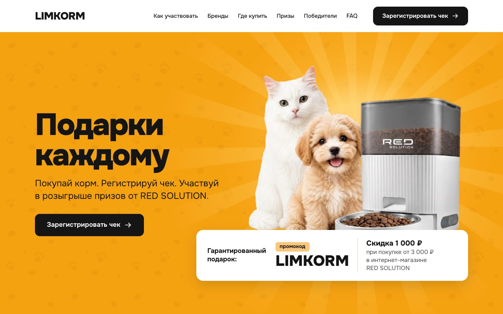
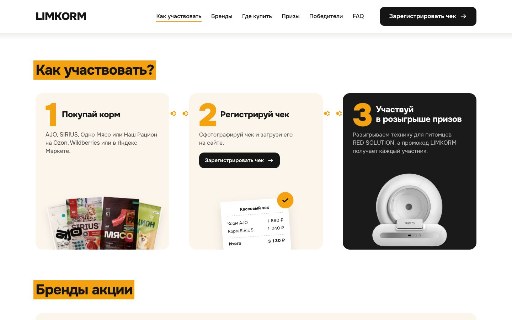
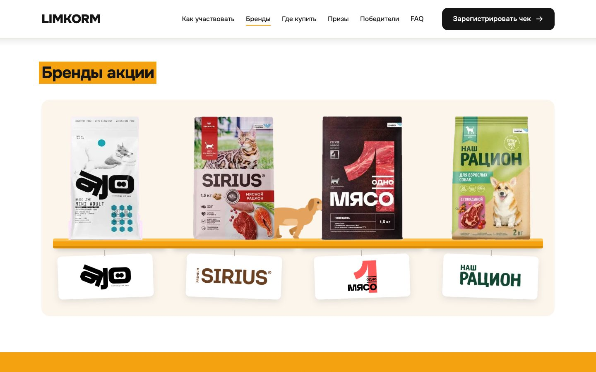
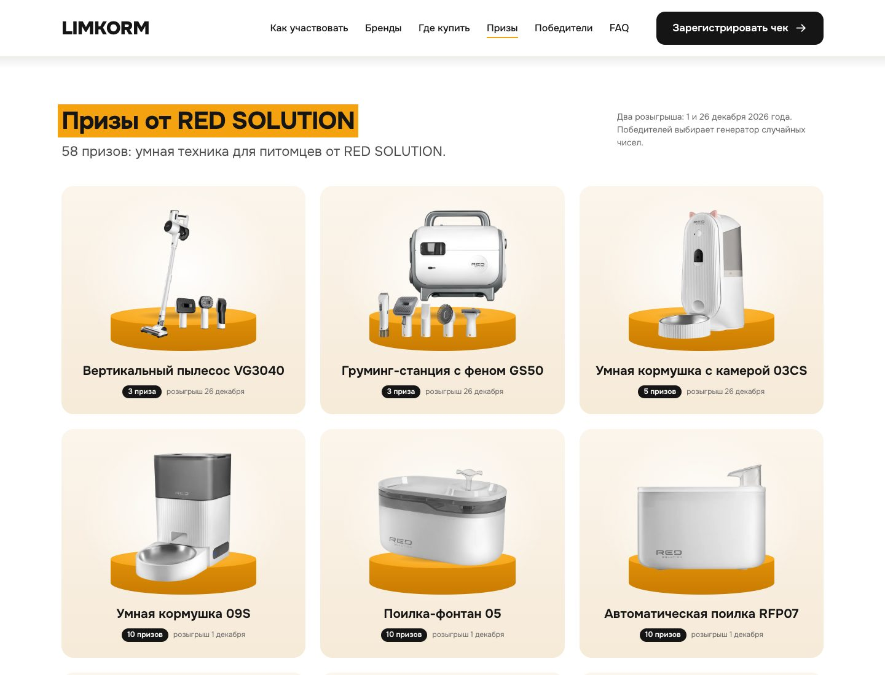
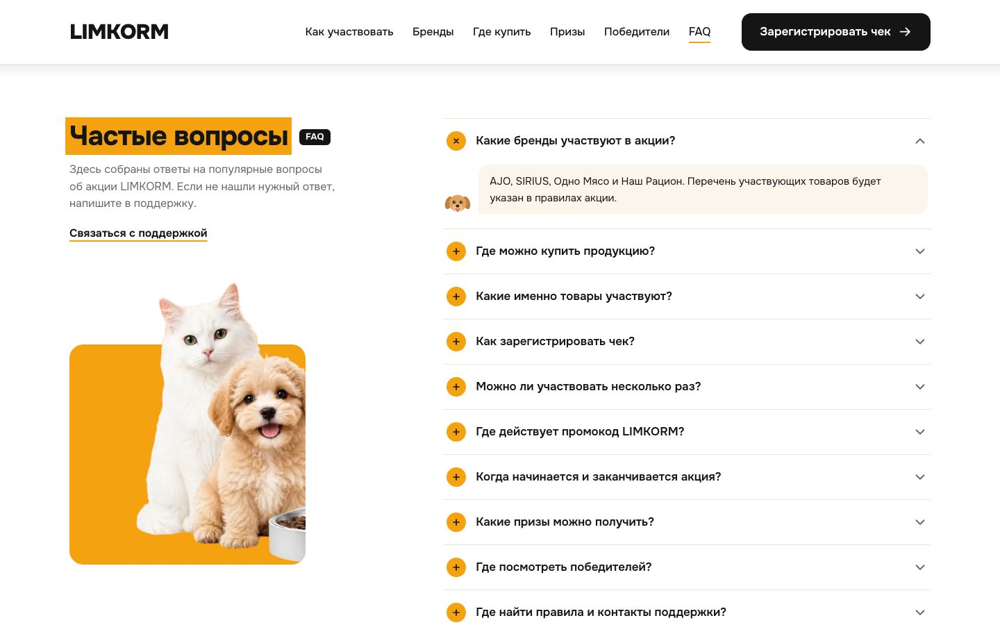
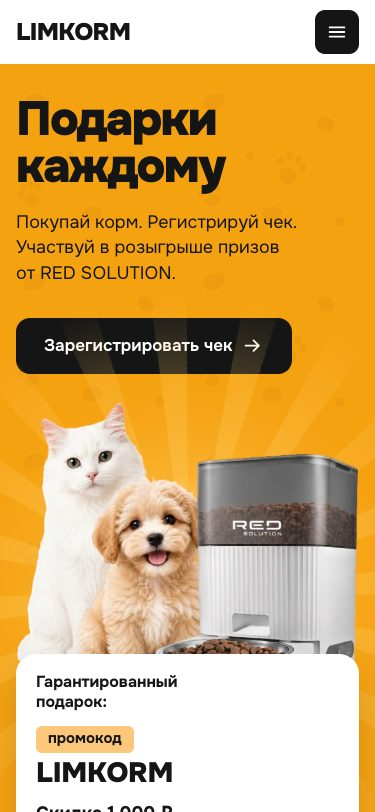
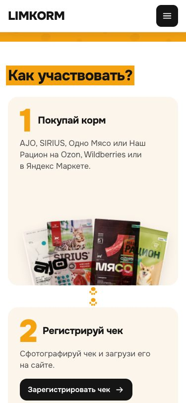
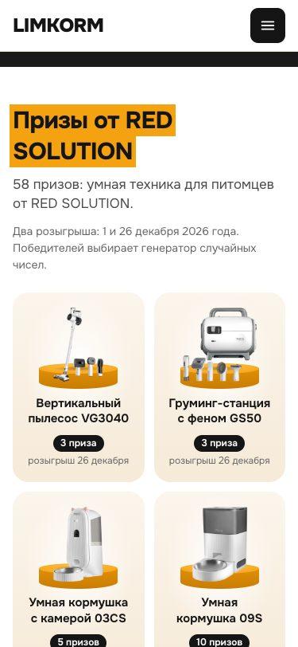
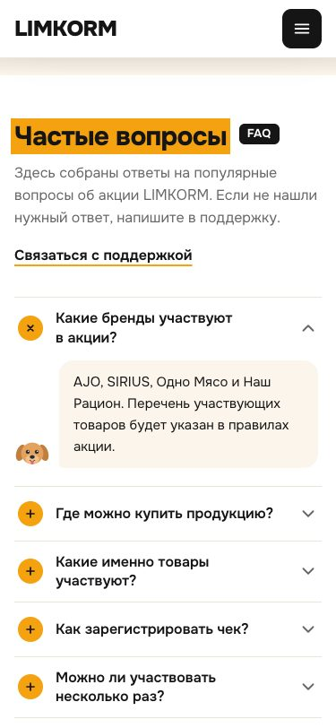

<div align="center">

# Red Solution & Limkorm "Gifts for Everyone"

**Promo site for a giveaway: buy pet food, register your receipt, win smart devices for your pets**

[](https://serene-croquembouche-d9e862.netlify.app/)


[**Open the site →**](https://serene-croquembouche-d9e862.netlify.app/)



</div>

## About

Landing page for a joint giveaway by the pet food maker **LIMKORM** (AJO, SIRIUS, "Odno Myaso", "Nash Ratsion") and the appliance brand **RED SOLUTION**. The giveaway runs from 1 November to 26 December 2026. Every participant gets a LIMKORM promo code for a 1,000 ₽ discount, and 58 prizes are drawn among participants.

The site is built without frameworks or a build step: HTML5, CSS3 and vanilla JavaScript. The only library is GSAP, used for the scene with running pets, and it is stored next to the code.

## How it looks

### How to take part and the brands

<p align="center">
  
  
</p>

The three steps are connected by a trail of paw prints. The brands stand on an orange shelf, and a dog and a cat run between the packs.

### Prizes

<p align="center">
  
</p>

Nine products stand on orange podiums under a soft spotlight. Each card shows how many prizes are drawn and on which day.

### FAQ

<p align="center">
  
</p>

### Mobile version

<p align="center">
  
  
  
  
</p>

## What's inside

- **Hero with a guaranteed gift**: LIMKORM promo code with a 1,000 ₽ discount on orders from 3,000 ₽, and a copy button.
- **How to take part**: three cards, the last one with its own dark theme and a prize photo.
- **Brands**: a GSAP scene where pets chase the packs; the animation only runs while the scene is on screen and is disabled with `prefers-reduced-motion`.
- **Where to buy**: Ozon, Wildberries, Yandex Market.
- **Prizes**: 9 RED SOLUTION products, 58 prizes, two draws (1 and 26 December 2026).
- **Receipt registration form** with field validation and a demo submit state.
- **Winners and a pet quiz**.
- **FAQ** built on `<details name>`: only one answer is open at a time.
- **Countdown to the giveaway start** with the start date; hidden after 1 November or by button.

## Technical decisions

| Topic | Decision |
| --- | --- |
| Stack | HTML5, CSS3, vanilla JS; no build step or dependencies, GSAP 3.12.5 is stored locally |
| Design system | CSS variables: colors, a `clamp()` type scale, radii, spacing |
| Palette | orange `#f5a211`, graphite `#151515` / `#1a1a1a`, cream `#fbf5ec` |
| Font | Onest (Cyrillic and Latin), local woff2 |
| Responsive | mobile-first; checked at 375, 768, 1024 and 1440 px, no horizontal scroll |
| Animation | only `transform` and `opacity`; `prefers-reduced-motion` respected; the brands scene stops off screen |
| Accessibility | semantic markup, visible focus, `aria` attributes in the menu, dialogs and FAQ, contrast at least 4.5:1 |
| Images | WebP, explicit `width` and `height`, `loading="lazy"` below the first screen |
| SEO | `title`, `description`, Open Graph, favicon |

## Project structure

```
.
├── site/                 the site itself (published as is)
│   ├── index.html        markup, SVG icon sprite, dialogs
│   ├── css/styles.css    tokens and styles
│   ├── js/               menu, forms, quiz, countdown, brands scene
│   └── assets/           fonts, images, logos, prizes
├── docs/screenshots/     screenshots for this README
├── netlify.toml          publishes the site folder
└── CLAUDE.md             project development rules
```

More about assets and the scenarios that were tested: [site/README.md](site/README.md).

## Run locally

```bash
cd site
python3 -m http.server 8000
# open http://localhost:8000
```

You can also open `site/index.html` by double-click, but copying the promo code to the clipboard only works on `localhost` or over HTTPS.

## Deployment

The site is deployed to Netlify from this repository. The setup is in [netlify.toml](netlify.toml): the `site` folder is published, there is no build step.

## Demo mode

This is a front-end build for approval. Receipt registration, winners and the quiz work in demo mode and send nothing to a server. What needs to be connected for launch is described in [site/README.md](site/README.md).
